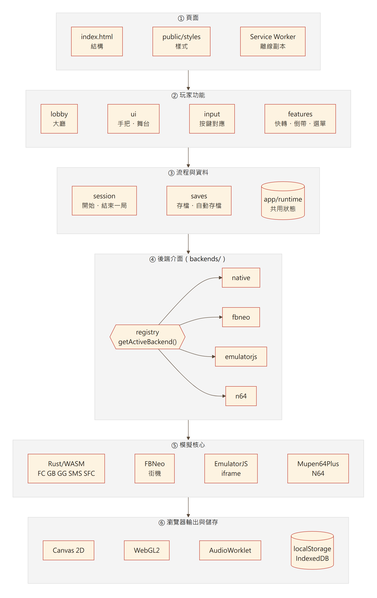
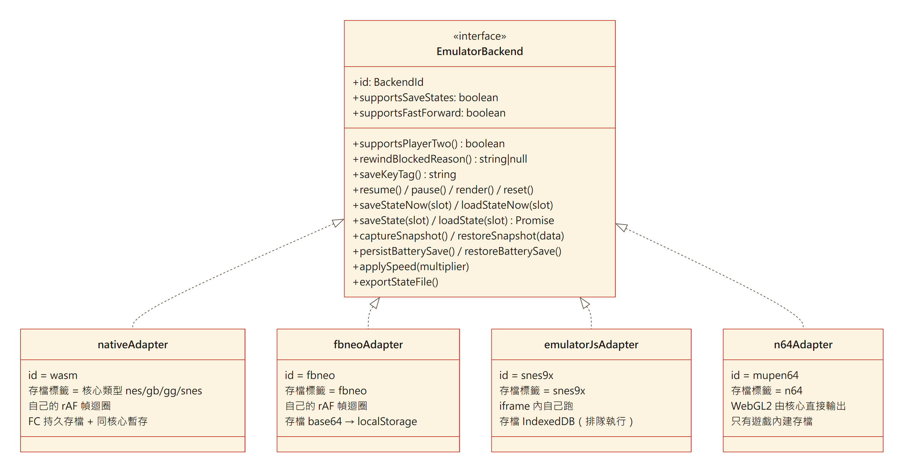
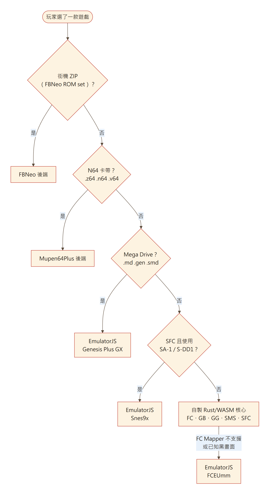
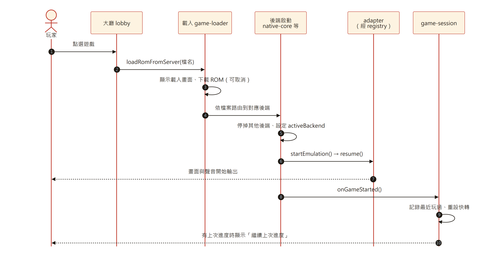
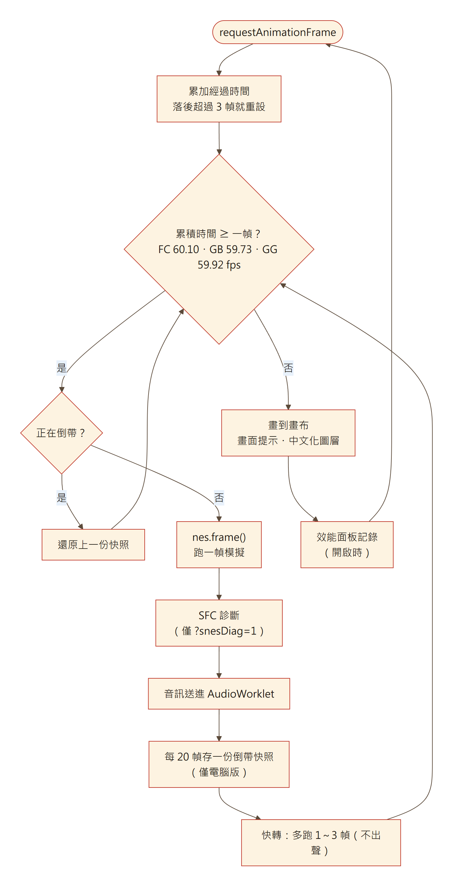
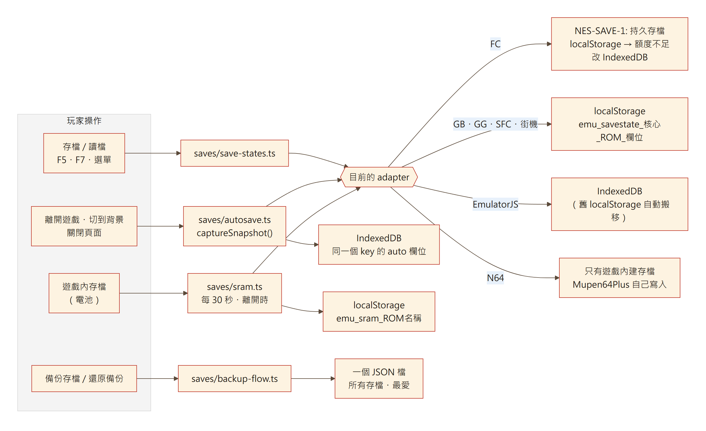
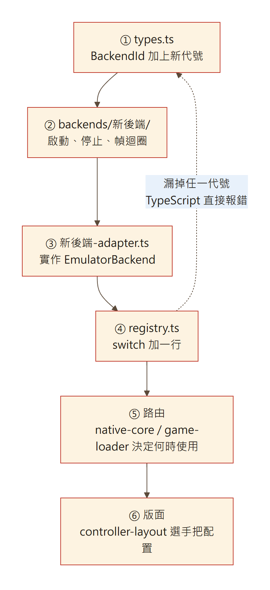

# H5-EMU 技術架構說明書

這份文件說明 H5-EMU 前端與模擬後端如何分工、資料怎麼流動，以及新增功能或主機時該改哪裡。
讀者對象是要維護或擴充這個專案的開發者。玩家操作請看[使用手冊](USER_MANUAL.md)。

> 圖檔由 `docs/images/architecture/src/*.mmd`（Mermaid）產生。修改圖時請一併更新原始檔。

## 目錄

1. [系統總覽](#1-系統總覽)
2. [模組職責](#2-模組職責)
3. [後端介面 EmulatorBackend](#3-後端介面-emulatorbackend)
4. [ROM 路由](#4-rom-路由)
5. [一局遊戲的生命週期](#5-一局遊戲的生命週期)
6. [幀迴圈與時序](#6-幀迴圈與時序)
7. [存檔架構](#7-存檔架構)
8. [輸入、音訊與畫面](#8-輸入音訊與畫面)
9. [共用狀態的規則](#9-共用狀態的規則)
10. [效能](#10-效能)
11. [擴充指南](#11-擴充指南)
12. [測試、驗證與部署](#12-測試驗證與部署)
13. [已知限制](#13-已知限制)

---

## 1. 系統總覽



系統分成六層，上層只依賴下層：

1. **頁面**：`index.html` 只放結構。樣式在 `public/styles/` 與 `public/*.css`。正式版另有 Service Worker 提供離線副本。
2. **玩家功能**：大廳、手把版面、按鍵對應、快轉與工具選單。
3. **流程與資料**：開始與結束一局遊戲、存檔，以及跨模組共用的執行期狀態。
4. **後端介面**：`getActiveBackend()` 依目前的後端回傳 adapter。上層不直接判斷「現在是哪個後端」。
5. **模擬核心**：自製 Rust/WASM、FBNeo、EmulatorJS、Mupen64Plus。
6. **瀏覽器能力**：Canvas 2D、WebGL2、AudioWorklet、localStorage 與 IndexedDB。

| 層 | 技術 |
|---|---|
| 前端 | TypeScript、Vite |
| 自製核心 | Rust → WebAssembly（wasm-pack、wasm-opt -O3） |
| 街機 | FinalBurn Neo（Emscripten） |
| Mega Drive 與備援核心 | EmulatorJS（同源 iframe） |
| N64 | Mupen64Plus Web（WebGL2、自建 fork） |
| 測試 | Vitest、`cargo test`、Playwright 視覺回歸 |
| 部署 | GitHub Actions → GitHub Pages |

---

## 2. 模組職責

`src/main.ts` 只負責依序啟動各模組，本身不含業務邏輯。

| 目錄 | 職責 | 重要檔案 |
|---|---|---|
| `app/` | 共用狀態、偏好設定、儲存小工具、除錯入口 | `runtime.ts`、`preferences.ts`、`storage.ts`、`debug-globals.ts` |
| `backends/` | 後端介面、登錄表、四種後端的啟動與 adapter | `types.ts`、`registry.ts`、`lifecycle.ts`、`active.ts` |
| `backends/native/` | 自製核心：載入 ROM、幀迴圈、繪製、存檔、SFC 開發診斷 | `native-core.ts`、`native-loop.ts`、`native-saves.ts` |
| `backends/fbneo/` | 街機：ROM set、幀迴圈、畫面旋轉 | `fbneo-backend.ts`、`fbneo-adapter.ts` |
| `backends/emulatorjs/` | EmulatorJS iframe 的啟停與存檔佇列 | `emulatorjs-backend.ts`、`emulatorjs-saves.ts` |
| `backends/n64/` | Mupen64Plus 的啟停、WebGL 畫布、遙測 | `n64-backend.ts`、`n64-canvas.ts` |
| `saves/` | 存檔 key、即時存檔入口、自動存檔、SRAM、備份 | `save-keys.ts`、`save-states.ts`、`autosave.ts` |
| `session/` | 下載 ROM、載入畫面、返回大廳、一局的開始與結束 | `game-loader.ts`、`game-session.ts` |
| `input/` | 鍵盤、手把、觸控按鍵對應、快捷鍵 | `keyboard.ts`、`gamepad.ts`、`native-input.ts` |
| `lobby/` | 大廳、主機目錄、遊戲列表、大廳電視 | `lobby-view.ts`、`crt-preview.ts` |
| `features/` | 快轉、倒帶、手機工具選單、效能面板、設定 | `speed.ts`、`player-features.ts`、`perf-monitor.ts` |
| `audio/` | AudioContext、AudioWorklet 佇列、靜音 | `audio-output.ts` |
| `ui/` | 手把版面、觸控引擎、電腦版舞台、對話框、RWD | `controller-layout.ts`、`desktop-stage.ts`、`controls/` |
| `arcade/` `n64/` `snes/` | 外部核心的底層橋接 | `fbneo-core.ts`、`snes9x-backend.ts` |
| `game-profiles/` | 中文化圖層、選單覆蓋、數值調整 | `text-overlay.ts` |
| `wasm/` | wasm-pack 產物，不要手改 | |

Rust 核心在 `nes-wasm/src/`：根目錄是 FC，`gb/`、`gg/`、`snes/` 各是一台主機，`lib.rs` 提供統一的 `EmuWasm` API。

---

## 3. 後端介面 EmulatorBackend



`src/backends/types.ts` 定義所有後端共同的介面。其他模組一律這樣呼叫：

```ts
import { getActiveBackend } from '../backends/registry';

getActiveBackend().saveState(slot);
```

### 方法語意

| 方法 | 呼叫時機 | 約定 |
|---|---|---|
| `resume()` | 開始或繼續遊戲 | 呼叫前 `lifecycle` 已恢復 AudioContext |
| `pause()` | 暫停、離開、切換後端 | 呼叫前 `runtime.isRunning` 已設為 false |
| `render()` | 每次畫面更新、讀檔後 | 畫面由 iframe 或 WebGL 輸出的後端不做事 |
| `reset()` | 選單的「重置遊戲」 | N64 會重新開機同一片卡帶 |
| `saveStateNow` / `loadStateNow` | 主控台 `window.saveState` 與街機觸控存讀鈕 | 同步、回傳成功與否 |
| `saveState` / `loadState` | 玩家存讀檔 | 可跨重新整理保存 |
| `captureSnapshot` / `restoreSnapshot` | 自動存檔 | 必須在核心被拆掉前同步擷取 |
| `persistBatterySave` / `restoreBatterySave` | 每 30 秒、切到背景、離開時 | 遊戲內建的電池存檔 |
| `applySpeed(n)` | 快轉倍率改變 | 自己用幀迴圈快轉的後端不做事 |
| `saveKeyTag()` | 組存檔 key | **決定玩家存檔位置，不可更改** |

### 四種 adapter 的能力

| 能力 | native | fbneo | emulatorjs | n64 |
|---|---|---|---|---|
| 即時存檔與自動存檔 | ✔ | ✔ | ✔ | ✘ |
| 快轉 | 幀迴圈多跑 | 幀迴圈多跑 | libretro 快轉 | ✘ |
| 倒帶（電腦版） | ✔（中文化遊戲除外） | ✔ | ✘ | ✘ |
| 第二玩家 | FC、SFC | ✔ | ✔ | ✘ |
| 電池存檔 | localStorage | 無 | EmulatorJS 自行同步 | Mupen64Plus 自行寫入 |
| 重置 | 核心 reset | 不做事（核心無 API） | libretro reset | 重新開機 |
| 存檔標籤 | `nes` `gb` `gg` `snes` | `fbneo` | `snes9x` | `n64` |

`backends/active.ts` 仍保留 `isSnesCore()` 這類判斷，給手把版面與按鍵對應使用。這些屬於「該顯示哪種手把」的 UI 決策，不屬於後端行為。

---

## 4. ROM 路由



路由分兩個地方：

- `session/game-loader.ts` 先判斷街機 ROM set（`isFbNeoArcadeRomName`）。
- 其餘交給 `backends/native/native-core.ts` 的 `startGame()`。它依副檔名送去 N64 或 Mega Drive；SFC 用 `shouldUseSnes9x()` 判斷是否有 SA-1、S-DD1。FC 遇到自製核心不支援的 Mapper 或已知黑畫面時，改用 EmulatorJS FCEUmm。

每個後端啟動前都會先停掉其他後端，再設定 `runtime.activeBackend`，所以同一時間只會有一個 adapter 生效。

---

## 5. 一局遊戲的生命週期



### 開始

- `game-loader` 建立 `AbortController`。玩家在下載中返回大廳時，整個載入會被取消。
- 後端啟動成功後呼叫 `session/game-session.ts` 的 `onGameStarted()`：記錄「最近玩過」、重設快轉、同步按鍵狀態，並詢問是否繼續上次進度。

### 結束

`endGameSession()` 先同步擷取自動存檔，再拆核心。以下情況會觸發自動存檔：

- 返回大廳，或改玩另一款遊戲
- 頁面切到背景（`visibilitychange`）
- 關閉頁面（`pagehide`）
- 匯出備份之前

---

## 6. 幀迴圈與時序



自製核心與 FBNeo 都用 `requestAnimationFrame` 驅動固定步長迴圈：

- **固定步長**：依實機幀率累加時間，FC 60.0988、GB 59.7275、GG 59.92、FBNeo 60 fps。螢幕更新率不同也能維持正確遊戲速度。
- **防止雪崩**：落後超過 3 幀就直接重設，不會為了追進度連跑幾十幀。
- **快轉**：每個時間片多跑 1～3 幀，多跑的幀丟棄聲音，避免音訊佇列爆量。
- **倒帶**：電腦版每 20 幀存一份快照到環形緩衝，最多約 10 秒。按住時每 5 個顯示幀退回一份。
- **SFC 開發診斷**：開機狀態、黑屏與綠屏偵測、DSP 聲道。只在開發模式或網址帶 `?snesDiag=1` 時執行。

EmulatorJS 在 iframe 裡用自己的迴圈。Mupen64Plus 直接畫在 WebGL2 畫布上。這兩種後端的 `render()` 都不做事。

---

## 7. 存檔架構



### Key 格式（不可更改）

| 資料 | 位置 | Key |
|---|---|---|
| 即時存檔 | 依後端，見上圖 | `emu_savestate_<存檔標籤>_<ROM 名稱>_<欄位>` |
| 自動存檔 | IndexedDB | 同上，欄位為 `auto` |
| 電池存檔（自製核心） | localStorage | `emu_sram_<ROM 檔名>` |
| 存檔時間 | localStorage | 由 `features/save-meta.ts` 管理 |

`ROM 名稱`是檔名把英數與中日韓文字以外的字元換成 `_`，最多 60 字。規則在 `saves/save-keys.ts`。

### FC 的兩種存檔

- **同核心暫存 token**（`#NES-TEMP-2:`）：存在記憶體的 `WeakMap`，綁定目前的核心實例，速度最快、狀態最完整。永遠不寫進 localStorage。
- **持久存檔**（`NES-SAVE-1:`）：可跨重新整理。先寫 localStorage，額度不足時改寫 IndexedDB。

讀檔時，同一次遊玩中存過的欄位優先用 token，否則讀持久存檔。

### 相容性守則

- 不要改任何 key 的格式，也不要改 `saveKeyTag()` 的回傳值。
- Rust 端被序列化進存檔的結構（例如 `FceummFirResampler`）不能增減欄位，否則舊存檔會讀不進來。
- 改動核心後，用舊版 WASM 存一份檔、在新版讀入，確認接下來的畫面與聲音逐位元相同。驗證腳本的做法見[第 12 節](#12-測試驗證與部署)。

---

## 8. 輸入、音訊與畫面

### 輸入

- **鍵盤**：`ui/input-bindings.ts` 保存可自訂的配置（`h5emu.input-bindings.v1`）。`Esc`、`M`、`Tab`、`F1～F12` 保留給系統功能。
- **手把**：`input/gamepad.ts` 每幀輪詢，第一支為 1P、第二支為 2P。
- **觸控**：`ui/controls/` 是觸控引擎，負責扇形方向判定、多點觸控、隱形重疊區、巨集與連發。按鈕判定直接讀 DOM 實際位置，不另存座標。
- **N64**：Mupen64Plus 讀鍵盤事件，所以觸控與改鍵會轉送合成的鍵盤事件（`input/n64-keys.ts`）。
- **EmulatorJS**：iframe 內的快捷鍵以 `postMessage` 轉回主頁（`input/shortcuts.ts`）。

### 音訊

自製核心與 FBNeo 每幀把取樣送進 `public/audio-worklet.js`：

- 先累積 1,024 幀才開始播放，避免一開始就斷音。
- 佇列超過 24 個區塊就丟掉最舊的，避免延遲越積越大。
- 斷音與丟棄次數只在效能面板查詢時回報。

N64 用 Mupen64Plus 自己的 SDL 音訊。EmulatorJS 在 iframe 內出聲。

### 畫面與樣式

- `index.html` 依序載入 `public/styles/` 九個檔案與 `public/*.css`。**載入順序就是疊加優先序**，新樣式請加在正確的檔案，而不是往最前面插。
- 版面模式由 `ui/responsive.ts` 寫在 `body` 的 class 上，例如 `touch-device-mode`、`mobile-landscape-mode`、`desktop-ui`、`game-active`，以及 `n64-mode`、`arcade-mode`、`snes-mode` 這類主機 class。
- 機身畫風與按鍵外觀只改視覺，不改按鈕與畫面位置。

---

## 9. 共用狀態的規則

- **被多個模組寫入的狀態**放在 `app/runtime.ts` 的 `runtime` 物件，例如目前的核心、畫布、`activeBackend`、`isRunning`、目前 ROM。
- **只有一個模組寫入的狀態**由那個模組持有，以 `export let` 公開給別人讀取，例如 `snes9xBackend`、`fbneoCore`、`fastForwardLevel`。ES module 的匯入是唯讀的 live binding，別的模組改不了，寫入點因此一目了然。
- **循環匯入**：模組之間存在循環匯入，這是允許的，但模組載入時只能使用函式宣告。不要在模組最上層呼叫 `getActiveBackend()`，也不要在最上層讀取別的模組的 `let` 或 `const`。`registry.ts` 在函式內用 `switch` 取 adapter，就是為了避開這個問題。

---

## 10. 效能

### 效能面板

網址加 `?perf=1`，或遊戲中按 `F9`。關閉時量測點只做一次布林判斷。自動化量測可以呼叫 `window.h5Perf.snapshot()`。

### 量測結果

在桌機 Chrome 量測，另用 DevTools 把 CPU 降速 4 倍，模擬中低階手機。數字是每次畫面更新花在模擬上的平均時間，一幀的預算約 16.7 ms。

| 遊戲 | 後端 | 一般 CPU | 降速 4 倍 |
|---|---|---|---|
| 超級瑪利歐（FC） | 自製 WASM | 60 fps，約 4 ms | 約 44 fps，有斷音 |
| 瑪利歐樂園 2（GB） | 自製 WASM | 60 fps，約 1 ms | 60 fps |
| 超級瑪利歐世界（SFC） | 自製 WASM | 60 fps，約 3.5 ms | 約 45 fps，有斷音 |
| 瑪利歐賽車、阿拉丁 | EmulatorJS | 60 fps | 60 fps |
| Pac-Man、KOF 97 | FBNeo | 60 fps，約 1 ms | 60 fps |

### 已完成的最佳化

- **FC 音訊重取樣**：具名剖析顯示，FC 每幀約三成時間花在 FCEUmm 品質的 1,024 階 FIR 重取樣。內迴圈改成正向切片；乘積確定在 32 位元範圍內時用 32 位元乘法。輸出與原演算法逐位元相同，並有測試保證。
- **wasm-opt**：重新啟用 `-O3`，只允許 Rust 本來就會輸出的 WASM 功能，不提高瀏覽器需求。
- 合計 FC 每幀約 3.6 ms → 2.9 ms，GB 約快 13%，WASM 檔小 5%。

### Worker 的評估

目前**不把自製核心搬到 Web Worker**：

- 一般 CPU 下，所有核心都只用掉不到三成的幀預算，沒有長幀也沒有斷音。
- 只有 FC、SFC 在降速 4 倍時掉幀。
- 搬遷需要改寫輸入、畫面傳遞（OffscreenCanvas）、音訊、同步存檔與自動存檔、倒帶，以及每幀讀取核心記憶體的中文化圖層，風險高。

下一步是用效能面板在實機手機收集數據。若 FC、SFC 的模擬 fps 低於 60，或斷音持續增加，再把 Worker 遷移當成獨立專案進行。

---

## 11. 擴充指南

### 新增一個模擬後端



1. 在 `backends/types.ts` 的 `BackendId` 加上新代號。
2. 建立 `backends/<新後端>/`，負責啟動、停止與幀迴圈。啟動前先呼叫其他後端的 stop。
3. 實作 `<新後端>-adapter.ts`。`saveKeyTag()` 選一個以後永遠不會改的標籤。
4. 在 `registry.ts` 的 `switch` 加一行。漏掉的話 TypeScript 會直接報錯。
5. 在 `native-core.ts` 或 `game-loader.ts` 決定哪些 ROM 走這個後端。
6. 在 `ui/controller-layout.ts` 選擇手把配置，必要時在 `input/` 加按鍵對應。

### 新增玩家功能

- 需要依後端不同而改變行為：在介面加方法或能力旗標，由各 adapter 實作。不要在功能模組裡判斷後端。
- 需要存資料：新增 key 前先確認不會和既有 key 衝突，並決定是否要放進備份檔（`features/save-backup.ts`）。
- 新增樣式：放進對應的 `public/styles/` 檔案，確認不會改變既有按鈕的位置。

---

## 12. 測試、驗證與部署

| 指令 | 內容 |
|---|---|
| `npx tsc --noEmit -p .` | 型別檢查 |
| `npm run test:ci` | Vitest 前端測試 |
| `npm run test:rust` | Rust 核心單元測試（含 FIR 逐位元比對） |
| `npm run build` | 重建 WASM、型別檢查、產生正式版 |

### 重構時的回歸驗證

這次架構調整的每個階段，都用以下方式確認行為不變：

1. 用 `git worktree` 建出修改前的版本，與修改後的版本各自用 `vite preview` 啟動。
2. 用 Playwright 開 8 款遊戲，分別在手機直向、手機橫向、電腦版共 23 種組合截圖，比較逐像素雜湊與按鈕位置。
3. 跑一遍 FC 的存檔、讀檔、快轉、倒帶、返回大廳、繼續上次進度。
4. Rust 核心變動時，用 Node 直接載入新舊兩版 WASM，比對從開機起與讀入舊存檔後的畫面與聲音雜湊。

### 部署

推送到 `main` 後，GitHub Actions 會安裝 Rust 與 wasm-pack，依序執行 Rust 測試、前端測試與 `npm run build`，確認 `dist` 小於 1 GiB 後部署到 GitHub Pages。

---

## 13. 已知限制

- **N64**：沒有即時存檔與自動存檔，不支援快轉。iPhone 在複雜場景仍會卡頓。
- **EmulatorJS 遊戲**：不支援倒帶。
- **GB、GG 的讀檔**：讀檔後的聲音和「不讀檔一路玩下去」會有極小差異，不影響遊戲進度。這是既有行為，新舊版本相同。
- **`npm run lint`**：專案目前沒有 ESLint 設定檔，所以無法執行。
- **wasm-opt 功能清單**：若日後 Rust 預設輸出新的 WASM 功能，建置會在 wasm-opt 步驟明確失敗。屆時把該功能加入 `nes-wasm/Cargo.toml` 的清單即可。
