# H5-EMU 使用手冊

H5-EMU 是在瀏覽器裡玩的復古遊戲機，手機、平板、電腦都能用，不需要安裝。
這份手冊說明怎麼找遊戲、怎麼操作、怎麼存檔，以及遇到問題時怎麼辦。

> [!IMPORTANT]
> 本專案僅供學術、技術研究與個人學習使用。請只使用您依法持有的遊戲。

## 目錄

1. [第一次開啟：通關密碼](#第一次開啟通關密碼)
2. [支援的主機](#支援的主機)
3. [遊戲大廳](#遊戲大廳)
4. [用手機玩](#用手機玩)
5. [手機的「遊戲功能」選單](#手機的遊戲功能選單)
6. [用電腦玩](#用電腦玩)
7. [存檔：四種方式一次看懂](#存檔四種方式一次看懂)
8. [快轉與倒帶](#快轉與倒帶)
9. [鍵盤、手把與雙人遊戲](#鍵盤手把與雙人遊戲)
10. [加到主畫面與離線遊玩](#加到主畫面與離線遊玩)
11. [常見問題](#常見問題)
12. [進階：效能面板](#進階效能面板)

---

## 第一次開啟：通關密碼

第一次在一台裝置上開啟 H5-EMU，會先看到「請輸入通關密碼」。提示是「是誰給你網址的？」。

- 密碼不分大小寫，全形半形都可以。
- 答對一次後，這台裝置的這個瀏覽器就會記住，之後不用再輸入。
- 每次有三次機會。三次都答錯會鎖住一小時，重新整理也一樣；時間到後會再給三次機會。
- 換裝置、換瀏覽器、使用無痕模式或清除網站資料後，需要重新輸入一次。

---

## 支援的主機

| 主機 | 手機手把 | 存檔方式 |
|---|---|---|
| FC / NES（紅白機） | 十字鍵、A、B、SELECT、START | 即時存檔、電池存檔、自動存檔 |
| Game Boy | 同上 | 即時存檔、電池存檔、自動存檔 |
| Game Gear、Master System | 同上 | 即時存檔、電池存檔、自動存檔 |
| SFC / SNES（超任） | 加上 X、Y、L、R | 即時存檔、電池存檔、自動存檔 |
| Mega Drive | 六鍵手把 | 即時存檔、電池存檔、自動存檔 |
| 街機（Arcade） | 搖桿與最多六顆按鈕、投幣、組合鍵 | 即時存檔、自動存檔 |
| Nintendo 64 | 類比搖桿、C 鍵、Z、L、R | 只有遊戲內建存檔 |

---

## 遊戲大廳

打開網站後會先看到大廳。大廳像一本復古遊戲雜誌，往下滑就是「主機目錄」。

<table>
<tr>
<td width="50%">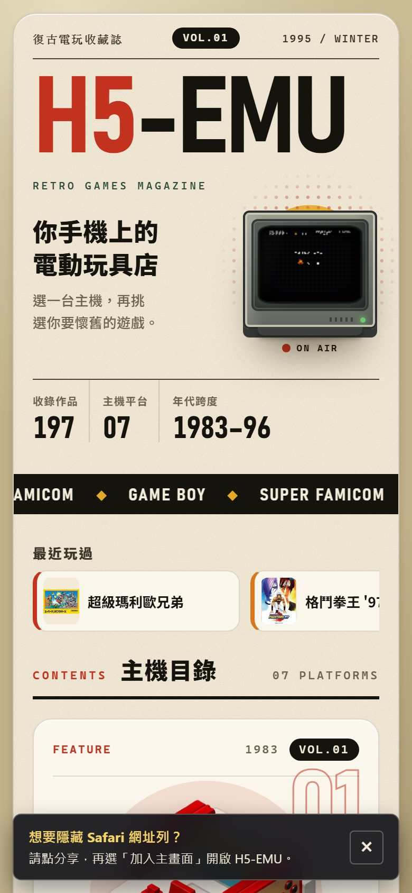</td>
<td width="50%">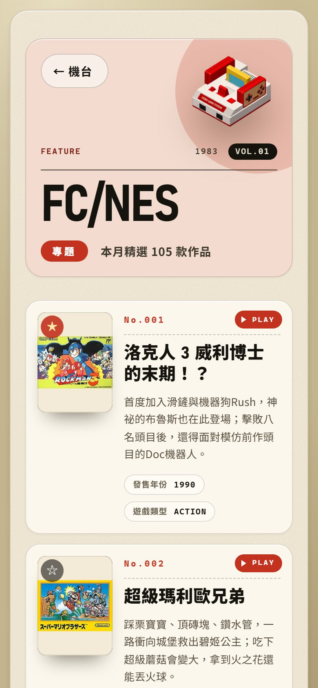</td>
</tr>
<tr>
<td>手機版大廳。中間的「最近玩過」可以左右滑動。</td>
<td>點進主機後的遊戲列表。左上角的星星可以加入最愛。</td>
</tr>
</table>

- **選主機，再選遊戲**：在「主機目錄」點一台主機，就會列出這台主機的所有遊戲。點遊戲卡片右上角的「▶ PLAY」或封面即可開始。
- **最近玩過**：玩過的遊戲會出現在大廳上方，可以左右滑動，點一下直接開始。
- **最愛**：點封面左上角的 ☆ 變成 ★，這款遊戲就會排到該主機列表的最前面。再點一次取消。
- **大廳電視**：電腦版大廳右上角的小電視正在播示範畫面，點一下就能直接開始玩。
- **返回主機目錄**：遊戲列表左上角的「← 機台」。

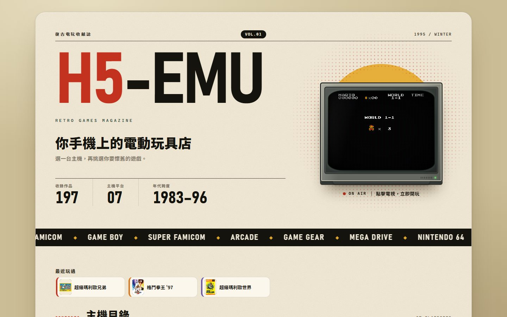

---

## 用手機玩

### 直向：Game Boy 機身

手機直拿時，畫面會變成一台 Game Boy。手把位置依主機自動切換，FC 是十字鍵加 A、B，N64 會多出類比搖桿與 C 鍵。

<table>
<tr>
<td width="50%">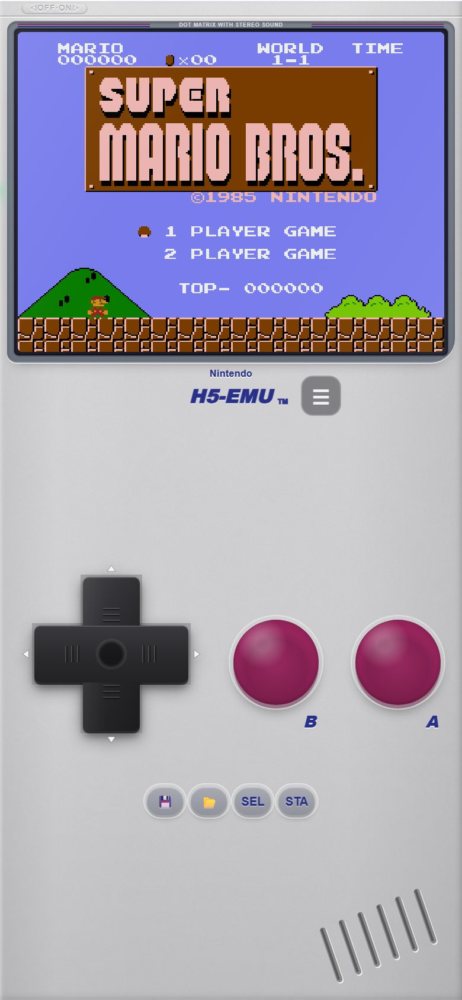</td>
<td width="50%">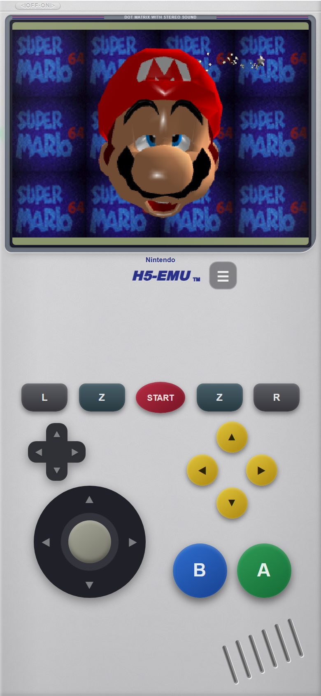</td>
</tr>
<tr>
<td>FC 遊戲。下方的 💾 是存檔、📁 是讀檔（第 1 格）。</td>
<td>N64 遊戲：左邊十字鍵與類比搖桿，右邊黃色 C 鍵與 A、B。</td>
</tr>
</table>

- 「H5-EMU」字樣旁的 **☰** 會打開「遊戲功能」選單，說明在[下一節](#手機的遊戲功能選單)。
- 手指按在十字鍵上往斜角滑，就能按出斜向。
- 遊戲中機身上的文字不會被選取，不用擔心誤觸跳出「拷貝」。

### 橫向：寬螢幕掌機

手機橫拿時，畫面放在中間，手把分在左右兩側，可以用兩隻手拇指玩。

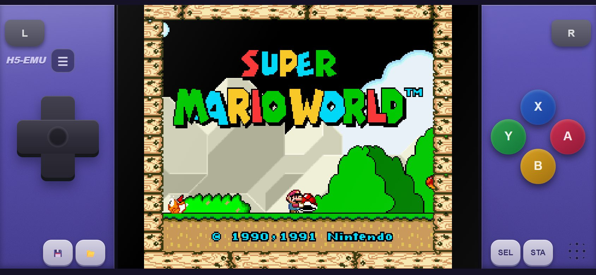

街機遊戲在橫向時會顯示投幣（COIN）、開始（START），以及 A+B、C+D 這類組合鍵。畫面上方的「指令」會在畫面邊緣顯示最近 15 個方向與按鍵，練習搓招時很好用。右下角的 SAVE、LOAD 是快速存讀檔。

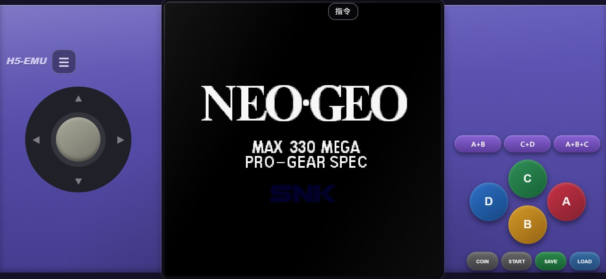

---

## 手機的「遊戲功能」選單

在遊戲中點 **☰**，會從下方拉出「遊戲功能」。右上角可以「返回大廳」或「關閉」。

<table>
<tr>
<td width="50%">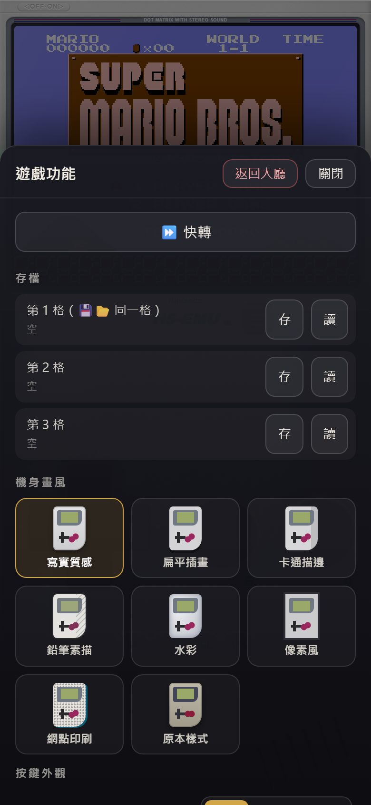</td>
<td width="50%">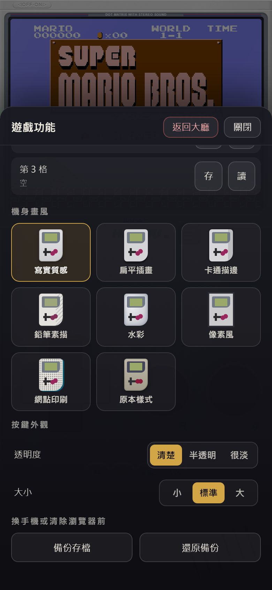</td>
</tr>
</table>

| 項目 | 用途 |
|---|---|
| **快轉** | 每按一次切換：關 → 2 倍 → 4 倍 → 關。適合跳過劇情或練功。 |
| **存檔** | 三個存檔格，每格都有「存」和「讀」。第 1 格和手把上的 💾 📁 是同一格。存過的格子會顯示存檔時間。 |
| **機身畫風** | 直向 Game Boy 的外觀：寫實質感、扁平插畫、卡通描邊、鉛筆素描、水彩、像素風、網點印刷，或「原本樣式」。只改外觀，按鈕位置不變。 |
| **按鍵外觀** | 透明度（清楚、半透明、很淡）與大小（小、標準、大）。 |
| **備份存檔／還原備份** | 換手機或清除瀏覽器資料前，先把所有存檔備份成一個檔案。詳見[存檔](#存檔四種方式一次看懂)。 |

---

## 用電腦玩

電腦版會把遊戲放進大型電玩機台的外框裡。左上角顯示主機與遊戲名稱，右上角有「☰ 選單」和全螢幕按鈕。

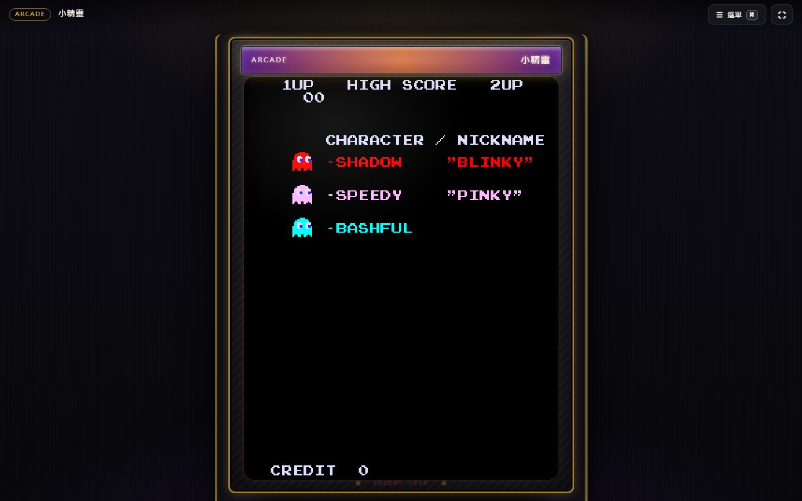

按 **M** 或 **F1**（或點右上角「選單」）會從右邊打開選單，共有四個分頁。

### 操作

暫停、重置遊戲、五個存檔欄位、快轉、備份與還原、載入本機 ROM、返回遊戲大廳。

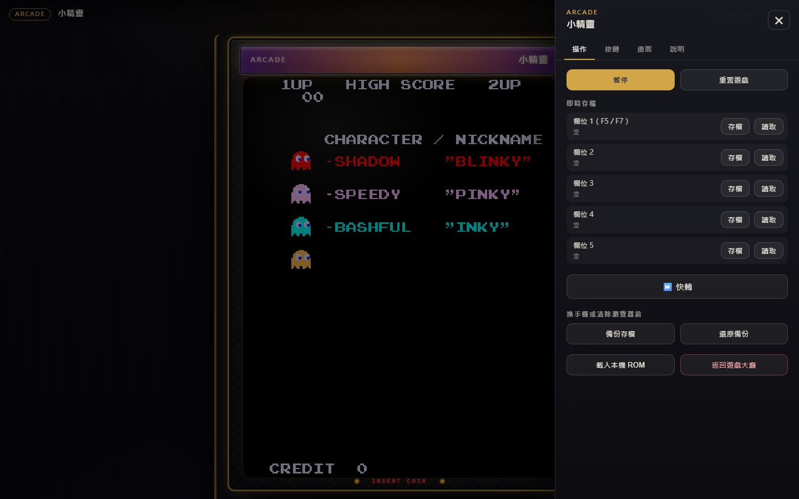

### 按鍵

可以改鍵。先選主機類型，點一個欄位，再按下想用的鍵盤按鍵或手把按鈕。`Esc` 取消、`Backspace` 清除。外接街機搖桿也能綁定。最下面的「還原此主機預設值」可以一鍵恢復。

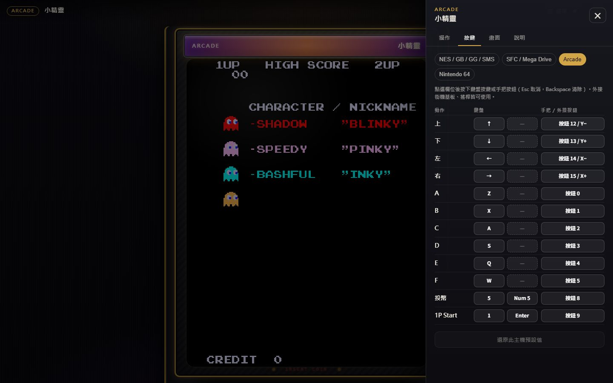

### 畫面

- **外框**：大型機台，或改回原本的主機外框。
- **主機外框**：關掉後畫面更大。
- **整數倍縮放**：像素邊緣更銳利；放不下時自動改回填滿。
- **掃描線**：疊上細橫紋，模擬映像管電視。

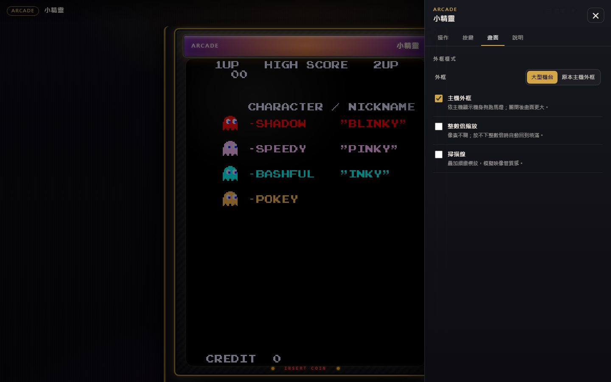

### 說明

列出所有快捷鍵，忘記時打開看就好。

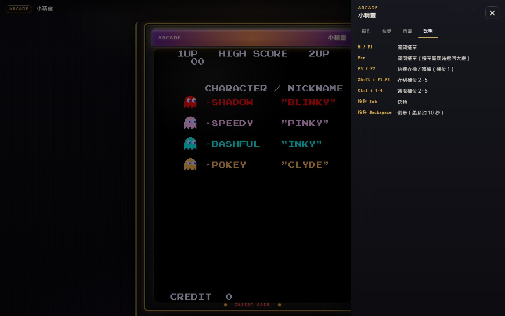

### 返回大廳

按 `Esc`（選單關閉時）或選單裡的「返回遊戲大廳」，會先跳出確認視窗，避免不小心離開。離開前會自動存一份進度。

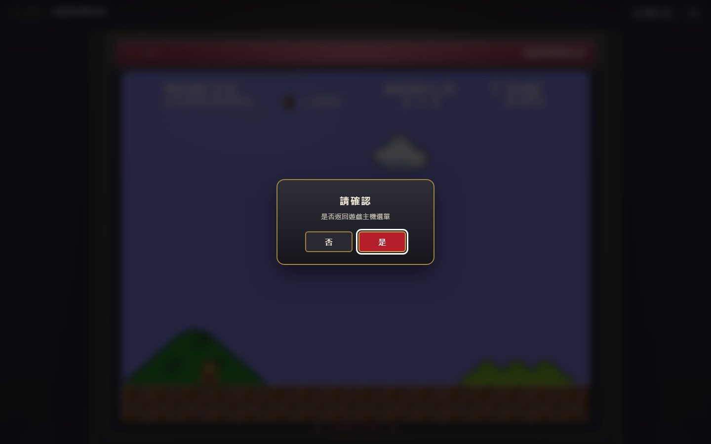

---

## 存檔：四種方式一次看懂

| 方式 | 怎麼用 | 存在哪裡 | 適合 |
|---|---|---|---|
| **即時存檔** | 手機 ☰ 選單或 💾 📁；電腦 `F5` 存、`F7` 讀，或選單的欄位 | 這個瀏覽器 | 打王前、難關前隨時存 |
| **自動存檔** | 不用做任何事 | 這個瀏覽器 | 臨時被打斷、忘記存檔 |
| **電池存檔** | 遊戲裡原本的「存檔」或「記錄」 | 這個瀏覽器，每 30 秒與離開時保存 | 像當年卡帶一樣的正式進度 |
| **備份檔** | 選單的「備份存檔」 | 下載到你的裝置 | 換手機、換電腦、清除瀏覽器前 |

### 自動存檔與「繼續上次進度」

以下情況會自動存一份進度：返回大廳、切換到別的 App 或分頁、關閉網頁、改玩另一款遊戲。

下次打開同一款遊戲，畫面上方會出現「上次玩到 ○○○」。點 **繼續上次進度** 就會回到離開時的畫面；點 ✕ 或等 12 秒，提示會自己消失，遊戲從頭開始。

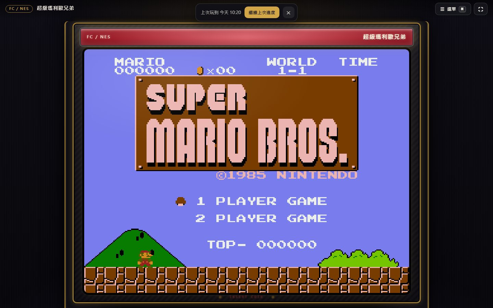

### 存檔欄位數量

- 手機：3 格。第 1 格與手把上的 💾 📁 共用。
- 電腦：5 格。`F5`／`F7` 是欄位 1；`Shift + F1～F4` 存到欄位 2～5；`Ctrl + 1～4` 讀取欄位 2～5。

### 備份與還原

「備份存檔」會下載一個 JSON 檔，裡面有即時存檔、電池存檔、N64 遊戲存檔與最愛清單。到新裝置打開 H5-EMU，在選單點「還原備份」選這個檔案即可。

> [!WARNING]
> 存檔都放在瀏覽器裡。清除瀏覽器資料、使用無痕模式，或換一個瀏覽器，存檔就看不到了。重要的進度請記得備份。

### N64 的存檔

N64 只能使用遊戲本身的存檔功能（例如《超級瑪利歐 64》會自動記錄星星），沒有即時存檔與自動存檔。

---

## 快轉與倒帶

- **快轉**：電腦按住 `Tab`，放開就恢復；手機在 ☰ 選單點「快轉」切換 2 倍、4 倍。快轉時畫面上方會顯示「⏩ 2×」。
- **倒帶**：電腦版按住 `Backspace`，畫面會往回倒，最多約 10 秒。

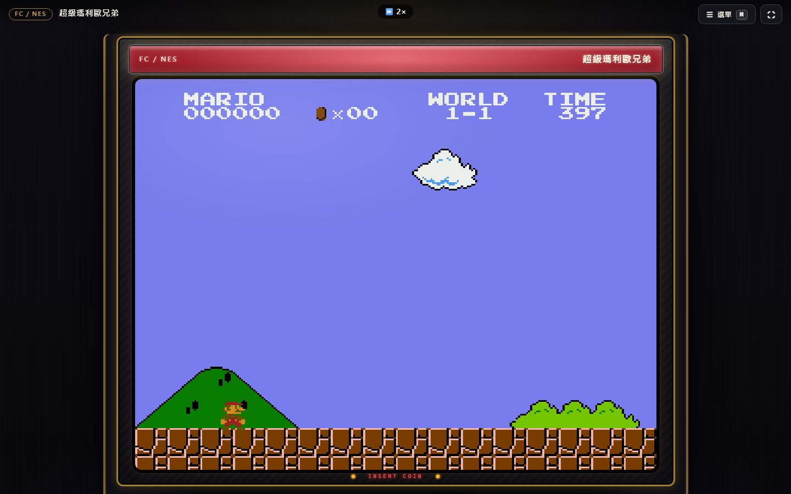

以下情況不能倒帶，按下時畫面會提示原因：

- 手機（選單會擋住畫面，無法邊看邊倒）
- N64、Mega Drive、使用特殊晶片的超任遊戲，以及少數改用備援核心的 FC 遊戲
- 中文化的遊戲

N64 不能快轉。

---

## 鍵盤、手把與雙人遊戲

### 預設鍵盤配置

| 主機 | 按鍵 |
|---|---|
| FC、GB、GG、SMS | 方向鍵移動，`Z` = A、`X` = B、`Enter` = START、右 `Shift` = SELECT |
| SFC、Mega Drive | 同上，另加 `A` = Y、`S` = X、`Q` = L、`W` = R |
| 街機 | 方向鍵移動，`Z` `X` `A` `S` `Q` `W` = A～F，`5` = 投幣，`1` 或 `Enter` = 開始 |
| N64 | 方向鍵 = 類比搖桿，`WASD` = 十字鍵，`IJKL` = C 鍵，左 `Shift` = A，左 `Ctrl` = B，`Enter` = START，`Z` = Z，`X` = L，`C` = R |

### 快捷鍵

| 按鍵 | 功能 |
|---|---|
| `M` 或 `F1` | 開關選單 |
| `Esc` | 關閉選單；選單關閉時返回大廳 |
| `F5`／`F7` | 存檔／讀檔（欄位 1） |
| `Shift + F1～F4` | 存到欄位 2～5 |
| `Ctrl + 1～4` | 讀取欄位 2～5 |
| 按住 `Tab` | 快轉 |
| 按住 `Backspace` | 倒帶 |
| `F9` | 開關效能面板 |

`Esc`、`M`、`Tab` 與 `F1～F12` 保留給上面這些功能，不能指派給遊戲按鍵。

### 手把與雙人

接上 USB 或藍牙手把就能直接玩，第一支是 1P。接上第二支手把，就會自動成為 2P。支援雙人的主機有 FC、SFC、Mega Drive 與街機。

---

## 加到主畫面與離線遊玩

- **iPhone／iPad**：用 Safari 打開，點「分享」→「加入主畫面」。之後從主畫面開啟，就沒有網址列，畫面更大。大廳下方第一次會出現提示。
- **Android**：用 Chrome 打開，選單裡選「安裝應用程式」或「加到主畫面」。
- **離線**：玩過的遊戲會在瀏覽器留一份副本。之後沒有網路時，同一款遊戲仍可以打開。

---

## 常見問題

### 沒有聲音？

瀏覽器要求先點一下畫面才能出聲。點一下遊戲畫面或按任一鍵。iPhone 請確認側邊的靜音開關沒有打開。

### 存檔不見了？

存檔放在瀏覽器裡。請確認用的是同一個瀏覽器、不是無痕模式，而且沒有清除網站資料。建議定期「備份存檔」。

### 倒帶沒有反應？

倒帶只在電腦版提供，而且 N64、Mega Drive、部分超任遊戲與中文化遊戲不支援。按下時畫面會顯示原因。

### 手機上畫面太小或被網址列擋住？

把網站「加入主畫面」後從主畫面開啟，或把手機轉成橫向。

### 遊戲很卡或聲音斷斷續續？

先關掉其他分頁與 App 再試。想知道是哪裡慢，可以打開下一節的效能面板，把截圖提供給開發者。

### N64 遊戲很慢？

N64 需要的運算量最大，較舊的手機可能無法全速執行。

---

## 進階：效能面板

在網址後面加上 `?perf=1`，或遊戲中按 `F9`，左上角會出現效能面板。再按一次 `F9` 關閉。

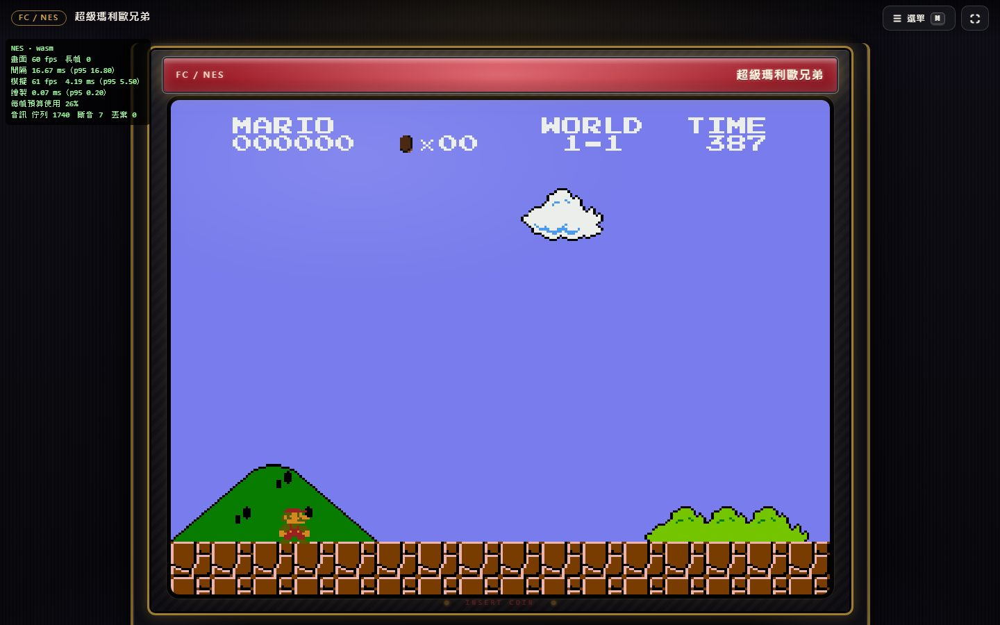

| 欄位 | 意思 | 正常值 |
|---|---|---|
| 畫面 fps | 每秒畫面更新次數 | 約 60 |
| 長幀 | 畫面卡住超過一下的次數 | 0 或很少 |
| 模擬 fps | 每秒跑了幾幀遊戲 | 約 60（快轉時更高） |
| 每幀預算使用 | 模擬加繪圖占用的時間比例 | 低於 100% |
| 斷音 | 聲音中斷的累計次數 | 不再增加 |

如果「模擬 fps」低於 60，或「斷音」一直增加，代表這台裝置跑這款遊戲比較吃力。
